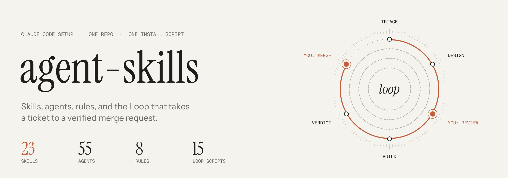
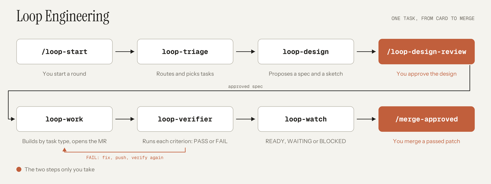

<p align="center">
  
</p>

<p align="center">
  <a href="#install"></a>
  <a href="https://claude.com/claude-code"></a>
  <a href="LICENSE"></a>
</p>

My Claude Code setup in one repo: the skills I use, the global instructions, a curated set of subagents, and Loop Engineering, which takes a ticket to a merge request that an independent agent has verified. Everything here uses example values. [Replace them](#replace-the-example-values) after you install.

## What is inside

| Folder | Count | Holds |
| :--- | :--- | :--- |
| [skills/](skills) | 23 | Skills in five buckets: engineering, productivity, design, loop, personal |
| [claude/agents/](claude/agents) | 55 | Subagents, one folder per category |
| [claude/rules/](claude/rules) | 8 | Code style, testing, self-improvement, explanation style, worktree commands, and three pstack rules |
| [loop/](loop) | 15 | The Loop Engineering runner, its scripts, and their tests |
| [scheduled/](scheduled) | 1 | The `daily-standup` task |
| [plugins.md](plugins.md) | 9 | Plugins to install with `claude plugin`. Their skills are not copied here |
| [docs/prompting-patterns.md](docs/prompting-patterns.md) | 11 | Prompts to copy. Reference only, never loaded |

## Install

```bash
git clone git@github.com:Jiranon-K/agent-skills.git ~/Projects/agent-skills
~/Projects/agent-skills/scripts/install.sh --dry-run
~/Projects/agent-skills/scripts/install.sh
```

The script installs each file in one of two ways:

- **Linked.** Generic skills and the Loop scripts are symlinks into this repo, so `git pull` updates them.
- **Copied once.** Everything that holds your own values is a template. The script copies it only when it is missing and never overwrites it.

`--force` replaces existing generic skills only, and moves the old ones to `~/.claude/backups/`.

After the script, install the plugins in [plugins.md](plugins.md) and run `/team-context` once per team.

### Replace the example values

| Placeholder | Means |
| --- | --- |
| `gitlab.example.com`, `example-team` | Your GitLab host and group |
| `workspace.example.com`, `APP-*`, `PB-*` | Your tracker URL and space keys, in `~/loop/workspace.md` |
| `project-a` / `web-app`, `project-b` / `project-b-web`, `project-b-api` | Your workspace folders and repos |
| `owner:you`, `your.username`, `@you` | Your MR label and usernames |

## Work a ticket by hand

These are the steps I run in one session, in order. Step 4 is for big work only.

| # | Stage | Run |
| --- | --- | --- |
| 1 | Understand the ticket | `/pstack:teach <ticket>` |
| 2 | Stress-test the plan | `/mattpocock-skills:grilling` |
| 3 | Write the spec | `/mattpocock-skills:to-spec` |
| 4 | Split into tickets | `/mattpocock-skills:to-tickets` |
| 5 | Build from the spec | `/mattpocock-skills:implement-spec` |
| 6 | Review the diff | `/mattpocock-skills:code-review` |
| 7 | Check in a browser | `/e2e` |
| 8 | Open the PR or MR | `/open-mr` |

To talk to the team, use `/reply`, `/blocker-ping`, and `/be-review`.

## Loop Engineering

<p align="center"></p>

The Loop takes the tasks assigned to you from card to merge request. You act twice per task: you approve its design, and you merge its MR.

1. **Start.** Type `/loop-start` for one round, or `/loop-start <task>` for one task. Nothing runs on a timer. When a session ends or a design is approved, `loop-next` starts the next round until you type `/loop-start stop`.
2. **Triage.** `loop-triage` routes each task to an agent or to a person, labels its type and risk, and asks one question on the card when the task is unclear.
3. **Design.** `loop-design` reads the code, compares at least two candidate designs, and proposes a spec. A bug gets a mechanism and a repro instead of a new structure.
4. **Your design gate.** `/loop-design-review` shows what will be built and a table of where the candidates differed, what was chosen, and why. Nothing is built until you approve.
5. **Build.** `loop-work` follows a playbook for the task's type and gives each kind of work to a named agent. It opens the MR ready, never as a Draft.
6. **Verdict.** The `loop-verifier` agent, which did not write the code, runs each acceptance criterion against the pushed branch and posts `PASS`, `PASS+NOTES`, or `FAIL` on the MR.
7. **Watch.** `loop-watch` asks every gate of the merge and prints `READY`, `WAITING`, or `BLOCKED`. The Worker fixes a failed pipeline or answers a review thread itself, twice at most.
8. **Your merge gate.** `/merge-approved` merges only a patch with a current pass.

Each session opens as a terminal in [Orca](https://orca.dev). Install the app, then add one folder as its workspace with `orca repo add --path <folder>`. The workspace is `~/Home` unless `LOOP_ORCA_WORKSPACE` names another folder.

### What keeps the gates real

- **A verdict covers one patch.** `loop-verdict` keys it by the `git patch-id` of the branch against its fork point. A new commit makes the verdict stale. A rebase that keeps the patch does not.
- **One script per risky action.** A Worker pushes only with `loop-push`, opens an MR only with `loop-mr`, and merges only inside `/merge-approved` with `loop-merge`.
- **A refused MR body.** `loop-mr` sends nothing unless the description has Why, What changed, Scope, Blast Radius, and Verification, with a diagram and a before and after.
- **Deny lists.** Sessions ask for no permission. `WORKER_DENY` and `DESIGNER_DENY` in `loop/bin/loop-run.sh` block force-push, merge, reset, `.env*`, and spec approval.
- **One limit you should know.** The verifier runs inside the Worker's session, so its independence is a rule in the `loop-work` skill. The harness cannot enforce it.

Logs, state, and summaries stay in `~/loop` and are never committed.

<details>
<summary><b>Loop scripts</b></summary>

| Script | Owns |
| --- | --- |
| `loop-run.sh` | One round: clean up, triage, open Designers and Workers |
| `loop-next` | Starting the next round when a session ends |
| `loop-orca` | Every call to Orca |
| `loop-state` | Each task's status, worktree path, session id, and verdict |
| `loop-spec` | Design status, approval, and the decision log |
| `loop-ask` | One read-only question to a model from another vendor |
| `loop-heavy` | One heavy command at a time across Workers |
| `loop-push` | The only push a Worker can do |
| `loop-mr` | Opening and editing the MR |
| `loop-verdict` | Recording the verifier's verdict and checking that it is current |
| `loop-watch` | Whether an MR is merge-ready |
| `loop-merge` | The gates and the merge behind `/merge-approved` |
| `loop-upload` | Uploading e2e screenshots to the MR |
| `loop-preview` | The dev server of a task's branch |
| `loop-clean` | Archiving finished tasks and removing their worktrees |

Run the tests with `for t in loop/test/*.test.sh; do bash "$t"; done`.

</details>

## Skills

<details>
<summary><b>All 23 skills</b></summary>

| Bucket | Skill | What it does |
| --- | --- | --- |
| engineering | `be-review` | Reviews a backend proposal from the frontend side |
| engineering | `e2e` | Checks the branch's changes end to end in a browser |
| engineering | `open-mr` | Pushes, waits for CI, opens the MR |
| engineering | `review-branch` | Simplifies, reviews, fixes, and splits commits before an MR |
| engineering | `ship-branch` | Runs review-branch, e2e, and open-mr as gated steps |
| productivity | `blocker-ping` | Drafts follow-ups for blockers that keep rolling over |
| productivity | `reply` | Drafts a reply in each person's tone |
| productivity | `team-context` | Interviews you and saves who is who per team |
| design | `ui-ux-pro-max` | Searches styles, palettes, fonts, and UX rules |
| personal | `ui-inspire` | Researches UI patterns, then designs an original UI |
| personal | `dev-challenge-generator` | Writes Frontend Mentor-style portfolio challenges |
| loop | `loop-start` | Starts a round or one task, and pauses or resumes the chain |
| loop | `loop-triage`, `loop-design`, `loop-work`, `loop-review` | The Coordinator, the Designer, the Worker, and the Reviewer |
| loop | `loop-design-review`, `merge-approved`, `loop-e2e` | Your gates: approve the design, merge the MR, run browser e2e by hand |
| loop | `loop-summary`, `loop-board`, `loop-explain` | Read-only views: what ran, every task by stage, one task explained from its record |
| loop | `loop-reflect` | Proposes edits to the loop skills from the week's sessions |

</details>

<details>
<summary><b>All 55 agents</b></summary>

| Category | Agents |
| --- | --- |
| engineering | `frontend-dev` `backend-dev` `minimal-fix` `docs-writer` `codebase-guide` `code-reviewer` `system-architect` `database-tuner` `devops` `rust-refactor` `translation-ready` `prototyper` `git-helper` `auth-engineer` `api-designer` `reliability-engineer` `incident-lead` `ai-feature-dev` `mcp-builder` `loop-reviewer` `loop-verifier` |
| design | `ui-designer` `ui-reviewer` `ux-architect` `ux-researcher` `brand-guardian` `visual-storyteller` `delight-designer` `persona-walkthrough` `image-prompt-writer` `inclusive-visuals` |
| testing | `e2e-tester` `api-tester` `speed-tester` `accessibility-checker` `reality-checker` `evidence-collector` `test-results-analyzer` |
| security | `security-reviewer` `ai-code-auditor` `secrets-guard` |
| product | `product-manager` `sprint-planner` `feedback-analyst` `trend-researcher` `dx-engineer` `nudge-designer` |
| project-management | `project-manager` `project-shepherd` `experiment-tracker` `jira-helper` `meeting-notes` `studio-ops` `studio-producer` |
| academic | `statistician` |

The Loop starts these by name: `frontend-dev`, `backend-dev`, `minimal-fix`, `docs-writer`, `e2e-tester`, `codebase-guide`, `security-reviewer`, `loop-reviewer`, and `loop-verifier`.

Most agents are adapted from [msitarzewski/agency-agents](https://github.com/msitarzewski/agency-agents). See [THIRD_PARTY_NOTICES.md](THIRD_PARTY_NOTICES.md).

</details>

## Scheduled task

| Task | When | What |
| --- | --- | --- |
| `daily-standup` | 17:47, Monday to Friday | Writes the standup for Discord from the day's sessions and git activity |

## The images

`scripts/readme-art.py --fonts <folder of the .ttf files>` draws both images. [docs/assets/design-philosophy.md](docs/assets/design-philosophy.md) describes the style.

---

<p align="center"><sub>MIT license. Agents and rules are adapted from MIT-licensed sources. See the <a href="THIRD_PARTY_NOTICES.md">notices</a>.</sub></p>
