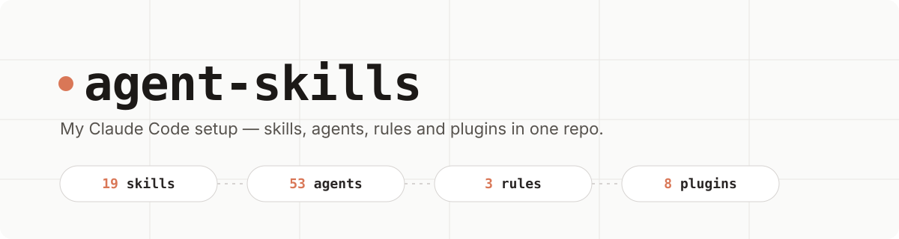

<p align="center">
  
</p>

<p align="center">
  <a href="#install"></a>
  <a href="https://claude.com/claude-code"></a>
  <a href="LICENSE"></a>
</p>

<p align="center">
  My personal Claude Code setup for side projects on my own machine, not a work or team setup.<br>
  The skills I actually use, the global instructions, curated subagents, and the Loop Engineering automation.<br>
  Shared with example values; see <a href="#setup-after-install">Setup after install</a>.
</p>

---

## How it maps

Generic skills are **symlinked**, so `git pull` keeps them current. Everything that holds your own setup is a **template**: copied only when missing, never overwritten.

## Daily workflow

<p align="center"></p>

To talk to the team: `/reply`, `/blocker-ping` and `/be-review`. Run `/team-context` once per team.

## What's inside

| Folder | Count | Holds |
| :--- | :--- | :--- |
| **[skills/](skills)** | 21 | engineering, productivity, design, loop, personal |
| **[claude/agents/](claude/agents)** | 53 | subagents grouped by category |
| **[claude/rules/](claude/rules)** | 5 | code style, testing, self-improvement, pstack in Thai, pstack models |
| **[plugins.md](plugins.md)** | 9 | installed with `claude plugin`, not copied |
| **[loop/](loop)** | — | Loop Engineering runner and launchd job |
| **[scheduled/](scheduled)** | 3 | daily-standup, loop-summary, loop-reflect |
| **[herdr/](herdr)** | — | terminal multiplexer configs |
| **[docs/prompting-patterns.md](docs/prompting-patterns.md)** | 11 | copy-paste prompts (reference, not loaded) |

<details>
<summary><b>Skills</b></summary>

| Bucket | Skill | What it does |
| --- | --- | --- |
| engineering | `be-review` | Reviews a backend proposal from the frontend side |
| engineering | `e2e` | Browser end-to-end check of the branch changes |
| engineering | `open-mr` | Pushes, waits for CI, opens the MR |
| engineering | `review-branch` | Simplify, review, fix, split commits before an MR |
| engineering | `ship-branch` | review-branch → e2e → open-mr in gated steps |
| productivity | `blocker-ping` | Follow-ups for blockers that keep rolling over |
| productivity | `reply` | Reply drafts in each person's tone |
| productivity | `team-context` | Interview that saves who is who per team |
| design | `ui-ux-pro-max` | Searchable styles, palettes, fonts, UX rules |
| personal | `ui-inspire` | Researches UI patterns, then designs an original UI |
| personal | `dev-challenge-generator` | Frontend Mentor-style portfolio challenges |
| loop | `loop-triage`, `loop-design`, `loop-work`, `loop-review` | Coordinator, designer (architect sketch and proposed spec), worker (one herdr session per task) and reviewer |
| loop | `loop-summary` | Shows summaries since last run |
| loop | `loop-design-review`, `merge-approved`, `loop-e2e` | Human gates: approve the design, merge the MR, browser e2e by hand when the Worker could not run it |
| loop | `loop-reflect` | Weekly learning pass that proposes edits to the loop skills |

</details>

<details>
<summary><b>Agents</b>, short names in one folder per category</summary>

| Category | Agents |
| --- | --- |
| engineering | `frontend-dev` `backend-dev` `code-reviewer` `system-architect` `minimal-fix` `database-tuner` `devops` `docs-writer` `rust-refactor` `codebase-guide` `translation-ready` `prototyper` `git-helper` `auth-engineer` `api-designer` `reliability-engineer` `incident-lead` `ai-feature-dev` `mcp-builder` |
| design | `ui-designer` `ui-reviewer` `ux-architect` `ux-researcher` `brand-guardian` `visual-storyteller` `delight-designer` `persona-walkthrough` `image-prompt-writer` `inclusive-visuals` |
| testing | `e2e-tester` `api-tester` `speed-tester` `accessibility-checker` `reality-checker` `evidence-collector` `test-results-analyzer` |
| security | `security-reviewer` `ai-code-auditor` `secrets-guard` |
| product | `product-manager` `sprint-planner` `feedback-analyst` `trend-researcher` `dx-engineer` `nudge-designer` |
| project-management | `project-manager` `project-shepherd` `experiment-tracker` `jira-helper` `meeting-notes` `studio-ops` `studio-producer` |
| academic | `statistician` |

Adapted from [msitarzewski/agency-agents](https://github.com/msitarzewski/agency-agents); see [THIRD_PARTY_NOTICES.md](THIRD_PARTY_NOTICES.md).

</details>

## Install

```bash
git clone git@github.com:Jiranon-K/agent-skills.git ~/Projects/agent-skills
~/Projects/agent-skills/scripts/install.sh --dry-run
~/Projects/agent-skills/scripts/install.sh
```

`--force` replaces existing generic skills only, moving the old ones to `~/.claude/backups/`. Then install the plugins in [plugins.md](plugins.md) and run `/team-context` once per team.

For [herdr](https://herdr.dev): `brew install herdr`, `herdr integration install claude`, and `brew install --cask herdr-app`. `install.sh` links both configs.

## Setup after install

<details>
<summary>Replace the example values in the copied templates</summary>

| Placeholder | Means |
| --- | --- |
| `gitlab.example.com`, `example-team` | your GitLab host and group |
| `workspace.example.com`, `APP-*`, `PB-*` | your Workspace tracker URL and space keys (`~/loop/workspace.md`) |
| `project-a` / `web-app`, `project-b` / `project-b-web`, `project-b-api` | your workspace folders and repos |
| `owner:you`, `your.username`, `@you` | your MR label and usernames |
| `/Users/YOUR_USER` | your home folder (launchd does not expand `~`) |

</details>

## Loop Engineering

<p align="center"></p>

Logs, state and summaries stay in `~/loop` and are not committed. To schedule it, copy `loop/launchd/com.example.loop.plist` to `~/Library/LaunchAgents/`, fix its paths, then:

```bash
launchctl load ~/Library/LaunchAgents/com.example.loop.plist
```

| Scheduled task | When | What |
| --- | --- | --- |
| `daily-standup` | 17:47 Mon–Fri | Standup for Discord from the day's sessions and git activity |
| `loop-summary` | 09:30 daily | Shows new loop summaries |
| `loop-reflect` | Friday 16:00 | Proposes edits to the loop skills from the week's runs |

---

<p align="center"><sub>MIT license. Agents and rules are adapted from MIT-licensed sources; see <a href="THIRD_PARTY_NOTICES.md">notices</a></sub></p>
